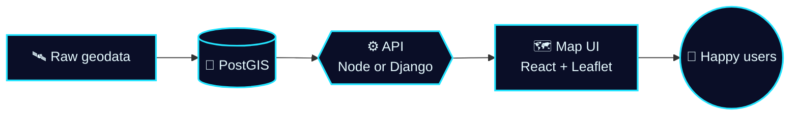
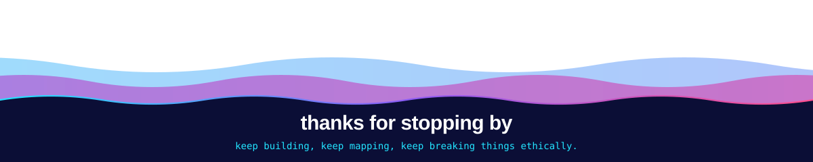

<!-- ============================== HERO ============================== -->
<div align="center">



<a href="https://github.com/JasonMomanyi">
  
</a>


</div>

<!-- ========================== VISITOR LOG ========================== -->
<div align="center">

<table>
  <tr>
    <td align="center" width="250">
      
    </td>
    <td align="left">
      <h3>Visitor log</h3>
      <sub>Every blip on the radar is someone who dropped by.</sub>
      <br><br>
      
      <br>
      <a href="https://github.com/JasonMomanyi"></a>
      <br>
      
    </td>
    <td align="center" width="210">
      
    </td>
  </tr>
</table>


</div>

<!-- ============================== ABOUT ============================== -->
<div align="center">



</div>

<br>

> [!NOTE]
> 🔭 **Interested in:** webapp development, pentesting and offensive sec, hacking Android applications, coding, anime and vulnerabilities.

> [!TIP]
> 🌱 **Currently learning:** JavaScript frameworks and Kotlin.

> [!IMPORTANT]
> 💞️ **Looking to collaborate on:** advanced WhatsApp bots in JavaScript, plus random code stuffs.

<div align="center">


<h3>
  
  ⚡ 永远不要鄙视任何人，没有人是有限的
</h3>
<sub><i>Never look down on anyone. No one is limited.</i></sub>

<br><br>

<table>
  <tr>
    <td align="center">
      
      <br>
      <p>DEAL WITH IT!!</p>
    </td>
    <td align="center">
      
      <br>
      <p>Its Not a Bug, Its a Feature!</p>
    </td>
  </tr>
</table>


</div>

<!-- =========================== TECH STACK =========================== -->
<h2 align="center">
  
  Tech Stack ⚙️
</h2>

<p align="center"><sub>Tools and technologies that I have worked with and I'm interested in</sub></p>

<p align="center">
  
</p>

<p align="center">
  
</p>

<p align="center"><sub>Tap a category to open or close it.</sub></p>

<details open>
<summary><b>🗺️ Geospatial and mapping</b></summary>
<br>
<p align="center">
  
  
  
  
  
  
  
  
  
</p>
<p align="center"><sub><code>geopandas</code>, <code>rasterio</code>, <code>shapely</code>, <code>pyproj</code>, <code>GeoJSON</code>, <code>EPSG:4326</code></sub></p>
</details>

<details open>
<summary><b>💻 Languages and frameworks</b></summary>
<br>
<p align="center">
  
</p>
</details>

<details>
<summary><b>🗄️ Data, cloud and tooling</b></summary>
<br>
<p align="center">
  
</p>
<p align="center"><sub>REST APIs, Django, ASP.NET, Nginx, Firebase</sub></p>
</details>

<details>
<summary><b>🛡️ Security lab</b></summary>
<br>
<p align="center">
  
  
  
  
  
  
  
</p>
</details>

<details>
<summary><b>📱 Mobile and game dev</b></summary>
<br>
<p align="center">
  
</p>
</details>

<br>

<!-- ============================ PIPELINE ============================ -->
<h3 align="center">How a map ships</h3>



<div align="center">


</div>

<!-- ======================== OPERATING SYSTEMS ======================== -->
<h2 align="center">
  
  Operating Systems ⚙️
</h2>

<p align="center"><sub>operating systems i have worked with</sub></p>

<div align="center">
<table>
  <tr>
    <td align="center" width="96"><br><sub>MicrosoftWindows</sub></td>
    <td align="center" width="96"><br><sub>Linux</sub></td>
    <td align="center" width="96"><br><sub>KaliLinux</sub></td>
    <td align="center" width="96"><br><sub>ArchLinux</sub></td>
    <td align="center" width="96"><br><sub>Ubuntu</sub></td>
    <td align="center" width="96"><br><sub>LinuxMint</sub></td>
    <td align="center" width="96"><br><sub>RedHat</sub></td>
    <td align="center" width="96"><br><sub>Debian</sub></td>
  </tr>
</table>


</div>

<!-- ============================ TELEMETRY ============================ -->
<h2 align="center">Live telemetry</h2>

<p align="center">
  
  
</p>

<p align="center">
  
</p>

<p align="center">
  
</p>

<details>
<summary><b>🏆 Trophy cabinet</b></summary>
<br>
<p align="center">
  
</p>
</details>

<br>

<p align="center">
  <picture>
    <source media="(prefers-color-scheme: dark)" srcset="https://raw.githubusercontent.com/JasonMomanyi/JasonMomanyi/output/github-snake-dark.svg">
    <source media="(prefers-color-scheme: light)" srcset="https://raw.githubusercontent.com/JasonMomanyi/JasonMomanyi/output/github-snake.svg">
    
  </picture>
</p>

<div align="center">


</div>

<!-- ============================ FUN ZONE ============================ -->
<h2 align="center">Fun zone</h2>

<p align="center">
  
</p>

<details>
<summary>🔒 <b>Classified. Do not open.</b></summary>
<br>

```text
$ sudo rm -rf /boredom
[sudo] password for visitor: ********

>> ACCESS GRANTED
>> Welcome to the matrix, visitor. 🐇
>> Fun fact: it works on my machine.
>> Bonus fact: there is no cloud, it's just someone else's computer.
```

</details>

<div align="center">


</div>

<!-- ============================ CONTACT ============================= -->
<h2 align="center">Open a channel</h2>

<p align="center">
  <a href="https://t.me/+254799884226"></a>
  <a href="https://discord.com/users/1092210946547654730"></a>
</p>

<!-- Second Telegram link from the old README, kept in case you want it back: https://t.me/+254747463828 -->

<!-- ============================== FOOTER ============================== -->
<p align="center">
  
</p>

<!---
JasonMomanyi/JasonMomanyi is a ✨ special ✨ repository because its `README.md` (this file) appears on your GitHub profile.
You can click the Preview link to take a look at your changes.
--->
